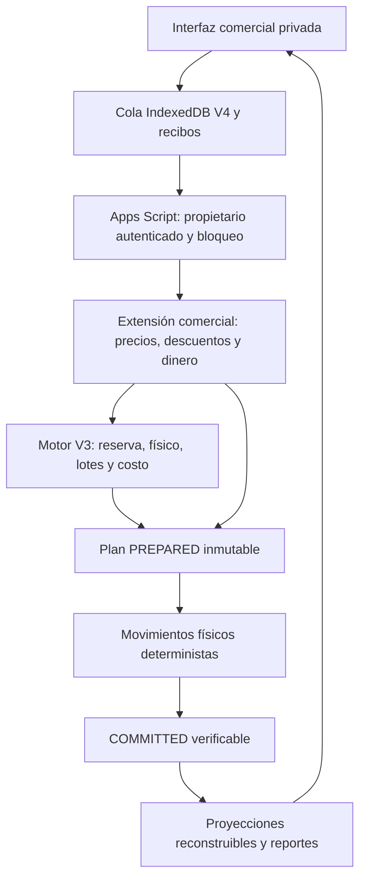

# Fase 4 — Integración comercial en laboratorio

## Alcance y límites

Aplicación privada de pruebas para Casa Vieja Café, separada del index.html productivo. Se conserva el motor V3 como autoridad de cantidades, lotes y costos. No migra datos ni sustituye la aplicación original. Solo datos, precios, personas y comprobantes ficticios. Ningún precio del laboratorio constituye una promoción comercial aprobada.

El diagnóstico y la matriz de correspondencia se presentaron antes de programar: DIAGNOSTICO.md. Esta entrega reúne nueve áreas operativas y configuración de catálogo, sin afirmar paridad con Fondo, conteos, restauración de backups o todas las herramientas originales.

## Arquitectura

Se reutilizan exclusivamente DiarioInventarioV3, MovimientosInventarioV3 y VerificacionesInventarioV3 de la hoja sintética autorizada. No se añade ninguna pestaña. Los eventos comerciales se almacenan en `plan.commerceEvents` dentro del mismo PREPARED; el marcador COMMITTED confirma el plan completo. No se aplican deltas económicos desde el navegador ni se editan filas antiguas.

El control transaccional, el bloqueo y la relectura durable de cada escritura proceden de V3. Un efecto comercial guardado en PREPARED solo aparece cuando la operación está confirmada. Los movimientos físicos siguen exclusivamente las validaciones de Inventory.Engine; pago, gasto, autorización y configuración de precios no generan consumo físico.

V2 y V3 conservan sus interfaces mediante `?lab=v2` y `?lab=v3`, con sus nombres anteriores de IndexedDB y RPC. La interfaz comercial usa una cola propia, `cv-commercial-sandbox-v4-owner`, y exige commercialVersion=4. Mantiene epoch TEST_ONLY_V3 porque consulta la misma autoridad física; los informes comerciales incluyen solo ventas y eventos comerciales nuevos. No reinterpretan ventas anteriores.

La ruta V3 de comandos rechaza de forma durable las acciones sobre un pedido marcado como comercial. Así, un despacho de V4 no puede pasar por esa ruta omitiendo sus efectos económicos. La vista de pedidos V3 filtra los pedidos V4; sus saldos físicos siguen reconstruidos por el motor común. Las rutas anteriores y de mantenimiento se conservan para pruebas privadas, no constituyen permisos productivos multioperador.

## Modelo comercial

| Entidad/evento | Datos y regla |
|---|---|
| OFFER | Oferta versionada: familia, molienda, gramos, bolsas por presentación, precio, vigencia y estado |
| DISCOUNT_AUTHORIZATION | Propietario, pedido objetivo, importe máximo, motivo, expiración y uso único |
| ORDER_REGISTERED | Líneas, snapshots de ofertas, precio bruto, descuento y total definitivo del backend |
| PAYMENT / REFUND | Importe de dinero recibido/reembolsado, medio, referencia única y operación de origen |
| DISPATCH_RECOGNIZED | Ingreso por despacho, costo histórico vendido y distribución del pedido |
| RETURN_CREDIT | Crédito por producto recibido y reversión de su costo vendido, sin alterar la venta original |
| OPERATING_EXPENSE | Gasto operativo, categoría, proveedor ficticio, documento y estado inicial de pago |
| EXPENSE_PAYMENT | Pago de un gasto ya registrado, con límite en su saldo; no suma otro gasto |
| CAPITALIZED_COST | Compra/procesamiento incorporado al valor del inventario; referencia única |
| PURCHASE_PAYMENT | Salida de dinero por costo capitalizable existente; no duplica gasto en resultados |
| STOCK_LOSS | Valor retirado por merma extraordinaria V4; las mermas normales de transformación quedan capitalizadas por V3 |

Los importes son céntimos enteros. Se conserva costo histórico por consumo confirmado; los precios nuevos no recalculan ventas anteriores. Los descuentos se distribuyen por diferencias proporcionales acumuladas, para que las devoluciones parciales sumen exactamente el precio neto original. El backend comprueba la vigencia del precio y de la autorización contra su propio reloj.

Las referencias de comprobantes se normalizan con trim/mayúsculas y no se reutilizan entre documentos económicos. No es un detector semántico de facturas: dos referencias diferentes pueden describir erróneamente la misma compra. El registro exige que el operador identifique correctamente el documento de origen.

## Política financiera operativa

- Registrar pedido reserva café y costo, pero no significa cobro ni ingreso por despacho.
- Despachar reconoce el importe con envío cobrado y el costo vendido, y registra una sola vez la distribución indicada en ese pedido.
- Cobros parciales o completos son eventos separados. No se acepta un cobro mayor al saldo. El indicador histórico paid de V3 no se transforma en dinero recibido.
- Cancelar antes del despacho libera reserva. Un anticipo cobrado no desaparece: queda por reembolsar.
- Recibir devolución repone físico/costo por V3 y genera crédito comercial por los productos recibidos. El dinero se devuelve mediante REFUND; no se inventa una salida de caja.
- La política de prueba conserva el envío cobrado tras devolver productos. No hay devolución automática de envío ni cancelación de costo de distribución ya incurrido. Una política diferente requerirá un ajuste comercial explícito, nunca editar la venta original.
- Las compras de café, empaques y procesamiento se capitalizan y se reconocen como costo al despachar. Pagar la compra no vuelve a restarlas del resultado.
- Publicidad, administración, transporte general y otros gastos son OPEX. El envío incluido en el pedido no debe registrarse otra vez como transporte vinculado: el backend bloquea ese vínculo explícito; el operador debe evitar duplicados con distinta referencia.
- Margen bruto estimado = ingreso despachado neto de créditos − COGS neto. Resultado estimado = margen bruto − distribución de pedidos − OPEX − merma extraordinaria V4.
- Cobros, reembolsos, pagos de compras y pagos operativos se muestran por separado; no se certifica un saldo bancario/caja ni una contabilidad fiscal. No incluye impuestos, depreciación o Fondo.

Los reportes filtran fecha de operación en Lima. Cuentas pendientes de cobro/reembolso son el saldo actual, no una reconstrucción de balance a la fecha de cierre del filtro. Los productos destacados muestran bolsas despachadas brutas, indicándolo expresamente; el ingreso y el costo sí se presentan netos de retornos. La recurrencia se basa en compras despachadas que no fueron devueltas por completo; el historial conserva también cancelaciones y devoluciones.

## Interfaz

Resumen, ventas simples/Tripack/combos, pedidos y cobros, inventario filtrable, lotes/preparación, compras, gastos, clientes y reportes, más catálogo versionado. Formularios de importes en soles y cantidades en gramos/unidades. La tabla de inventario es de solo lectura. Las acciones se habilitan según estado y versión del pedido. Se preservan filtros, tarjetas abiertas y formularios en edición durante la sincronización.

Una reserva se guarda en IndexedDB antes de informar que está pendiente. Solo un recibo válido permite confirmar. El identificador del borrador comercial persiste entre recargas; un pedido confirmado exige usar «Nuevo pedido» para crear otro. Los rechazos se archivan con evidencia del servidor y no se borran silenciosamente.

Datos de clientes: acceso privado del propietario; teléfono enmascarado en la vista de clientes hasta una acción explícita. Sin publicidad automática, envíos de mensajes ni exportación de contactos. El almacenamiento local no está cifrado: la protección del dispositivo y la cuenta siguen siendo necesarias antes de un uso real. Todo ensayo usa personas ficticias.

## Construcción y pruebas

`node fase1-aislada/fase4/build.cjs`

Instalar únicamente apps-script/Code.gs en el proyecto independiente autorizado. Incluye los paquetes anteriores, la extensión comercial y HTML embebido. No instalar Server.gs como archivo adicional ni duplicar funciones. apps-script/Index.html se entrega para inspección.

Regresión completa:

`node --test fase1-aislada/tests/acceptance.cjs fase1-aislada/fase2/tests/*.test.cjs fase1-aislada/fase3/tests/*.test.cjs fase1-aislada/fase4/tests/*.test.cjs`

La vista local `node fase1-aislada/fase4/preview.cjs` usa servicios Google simulados, datos ficticios y un servidor limitado a 127.0.0.1. No debe publicarse. Las capturas locales incluyen una barra visible que distingue esta simulación de Google real.

## Fase 5 recomendada, sin activación

1. Completar pruebas de carga/cuotas, paginación y proyecciones verificables: los lectores aún reconstruyen el diario completo.
2. Probar dos equipos físicos, red inestable prolongada, actualización de versiones y restauración aislada de respaldos.
3. Revisar permisos/roles, protección de datos locales, autorización de ajustes y cierre de rutas de mantenimiento antes de cualquier evaluación productiva.
4. Definir documentos monetarios, devolución de envío, recibos dañados/cuarentena, impuestos y conciliación de dinero como trabajo separado.
5. Evaluar Fondo, insumos adicionales, mínimos configurables, conteos prospectivos autorizados y paridad del resto de utilidades originales. No incluir Windsor/Meta automático todavía.
6. Mantener historial cerrado y original consultable. Ninguna prueba aprobada autoriza migración, reemplazo o activación comercial.
