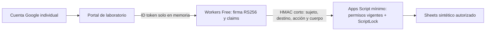

# Arquitectura multiusuario S/0 — decisión técnica

16/10/2026, Lima. Sustituye la recomendación económica anterior de Cloud Run: queda DESCARTADA para esta etapa porque requiere facturación. Base d2687de4fea1a659e5c4767f0770272bd2eaf315. Tres Gmail individuales; 3–10 ventas diarias. No se creó cuenta, recurso externo ni despliegue; no se usó ningún Gmail real.

## Recomendación

**Conservar Sheets y el motor Apps Script. Añadir Cloudflare Workers Free para verificar el inicio de sesión Google y entregar solicitudes firmadas al backend.** Portal estático en el mismo Worker con subdominio gratuito, sin comprar dominio. Google Identity Services identifica a cada persona; la tabla de permisos permanece en el backend Apps Script. No se requiere Firebase ni Supabase para esta ruta.

El costo obligatorio de los componentes propuestos es S/0 mientras se mantengan únicamente los planes gratuitos, sin medios de pago ni cuentas de facturación enlazadas. No es una promesa de disponibilidad ilimitada o de que los proveedores nunca cambien condiciones. Ante un límite, bloqueo o solicitud de pago se conserva la cola y se detiene la operación; jamás se cambia a un plan pagado automáticamente. Las variables del ejemplo no acreditan el plan real: hay que verificarlo en la consola antes de activar un laboratorio remoto.

## Cuatro alternativas comparadas

| Alternativa | Costo / tarjeta / facturación | Identidad y seguridad | Límites y disponibilidad | Mantenimiento / código actual | Resultado |
|---|---|---|---|---|---|
| Apps Script con Session e identidad nativa | S/0 en cuenta personal dentro de cuotas; no requiere contratar Workspace | Ejecutar como propietario puede dejar vacío el correo activo en Gmail externos. Ejecutar como usuario cambia su autoridad sobre Sheets; dar edición directa violaría el aislamiento solicitado | Cuotas por usuario/script; no servidor ilimitado | Mínimo cambio, pero Session sola NO acredita tres Gmail de forma confiable en el modo elegido | Descartado como autenticación única. Se conserva como motor y lock, detrás del verificador. |
| Sheets + Firebase Auth Spark | Spark no requiere método de pago; Google sign-in incluido. No activar Blaze, Cloud Run ni Functions; vincular billing puede actualizar automáticamente el plan | Autenticación gestionada por Google; el token Firebase todavía debe verificarse en un backend y autorizarse por UID. Login frontend por sí solo no protege Sheets | Cuotas Spark; sin backend Cloud Functions en este plan. Google Auth disponible; cuotas de Identity Platform varían según modalidad | Agrega SDK/proyecto/proveedor y adaptación del token. Apps Script no ejecuta Firebase Admin SDK de Node; habría que agregar verificador compatible o usar Worker | Viable S/0 como complemento, no solución completa por sí sola. No necesario para el PoC directo Google. |
| Sheets + Workers Free + Google Identity | Workers Free publicado a US$0, sin suscripción pagada. Alta Free sin tarjeta debe comprobarse antes de continuar; no crear cuenta si la exige. Cliente Google OAuth sin vincular billing | Worker verifica RS256 con JWKS fijo de Google, emisor/audiencia/sub/fechas. Apps Script verifica HMAC y relee permisos actuales; no hay acceso del vendedor a Sheets | 100000 solicitudes/día y 10 ms CPU por invocación. Al superar límites puede fallar; usar fail closed. Latencia y CPU reales pendientes | Reutiliza inventario/ventas/idempotencia/ScriptLock. Nuevo puente pequeño con Web Crypto, sin servidor permanente, sin KV/D1/DO/IA/pagos | **Recomendada para laboratorio sujeto a aprobación y prueba remota.** |
| Supabase Free como nueva base | Free publicado a US$0/mes. No se verificó un alta hasta su final y no se añadirá tarjeta. Cualquier exigencia de pago descarta esta ruta | Google OAuth + Auth y RLS permiten permisos backend si se diseñan bien; nunca service_role en navegador | 500 MB DB, 50000 MAU, 5 GB egreso; pausa por inactividad de una semana, sin backups automáticos ni SLA en Free | Exige adaptar transacciones, SQL/RLS, diarios y recuperación; cambia el almacenamiento sin necesidad actual | No migrar. Queda alternativa futura, no seleccionada; la ausencia de verificación de alta impide garantizar ese punto. |

La referencia pública de alta Free de Cloudflare indicaba que no requiere tarjeta; el alta de esta cuenta NO se ejecutó. Esa condición deberá verificarse en la pantalla real antes de crear nada. No usar planes promocionales/estudiantes/trials que pidan tarjeta. Que un proveedor tenga plan Free no autoriza vincular facturación.

Fuentes primarias: [Session](https://developers.google.com/apps-script/reference/base/session), [modos Apps Script](https://developers.google.com/apps-script/guides/web), [cuotas](https://developers.google.com/apps-script/guides/services/quotas); [Spark y precios](https://firebase.google.com/pricing), [cambio por facturación](https://firebase.google.com/docs/projects/billing/firebase-pricing-plans), [verificar token Firebase](https://firebase.google.com/docs/auth/admin/verify-id-tokens); [Workers precios](https://developers.cloudflare.com/workers/platform/pricing/), [límites y fail closed](https://developers.cloudflare.com/workers/platform/limits/), [alta Free documentada](https://developers.cloudflare.com/labs/workers); [Supabase Free](https://supabase.com/pricing), [pausas](https://supabase.com/docs/guides/platform/free-project-pausing).

## Flujo y frontera de confianza

El token Google se verifica con claves del endpoint fijo de Google; se ignoran roles/nombres del navegador. No se acepta un JWT solo por decodificarlo. El token no va a Sheets ni a la cola ni al log. La prueba firmada no contiene el token o el correo, dura máximo 30 segundos y está ligada al contenido y destino TEST_ONLY_ZERO_1. Firma alterada o de protocolo anterior se rechaza antes de leer Sheets.

Backend: permisos y revocaciones se releen DENTRO del lock en cada solicitud, sin caché de autoridad. Los IDs comerciales y fingerprints se conservan. No se emplea memoria global de Workers como lock, saldo, lista de permisos ni fuente de inventario; las instancias pueden ser múltiples. Solo se cachean claves públicas por su vigencia. Repetir una venta devuelve su recibo original. Una cuenta deshabilitada no obtiene un recibo ni ejecuta nuevas operaciones; administrador debe resolver sus pendientes preservando el responsable original.

Tres perfiles ya confirmados:

| Función | Gerente 1 administrator | Gerente 2 operations | seller |
|---|---|---|---|
| Ventas/pedidos y disponibilidad | Sí | Sí | Sí |
| Cobros/despachos | Sí | Sí | No |
| Compras/lotes/preparación/inventario/gastos | Sí | Sí | No |
| Reportes financieros/costos | Sí | Sí | No |
| Usuarios/configuración crítica/precios | Sí | No | No |

En el PoC el vendedor consulta solo sus pedidos, y no edita/cancela pedidos porque ese permiso adicional no fue confirmado. Los gerentes pueden hacerlo. Reembolsos/devoluciones físicas siguen bloqueados hasta resolver las políticas pendientes; no se inventó una regla comercial. Gerente 2 puede registrar costos de compras/procesos dentro de sus operaciones confirmadas; no modifica el catálogo de precios ni asigna permisos.

## Riesgos concretos y condiciones para validar S/0 remoto

- Verificar que Google acepta el origen HTTPS gratuito elegido para el cliente OAuth y su modo de pruebas. No se ha validado workers.dev con esta cuenta. Si lo rechaza, detener: no comprar dominio. Evaluar Hosting/Auth Spark como alternativa gratuita solo con nueva aprobación.
- Worker Free: medir CPU real (incluido JWKS frío y firma) contra 10 ms y tres peticiones simultáneas. Node no reproduce la contabilidad de CPU del edge; los tests no la certifican. Si no cabe en Free, no subir a Paid: optimizar o informar que esa variante no sirve.
- Apps Script debe usar un proyecto nuevo MÍNIMO, sin helpers del laboratorio, apuntando exclusivamente a la hoja sintética. El endpoint firmado necesita alcance de red para que el Worker lo invoque: habilitarlo requiere aprobación específica. El proyecto privado actual no se abre a operadores.
- El HMAC limita acceso a datos pero no elimina ataques de agotamiento de cuotas al endpoint público. Validar firma antes de Sheets, fail closed y conservar cola cuando no haya capacidad. No se promete SLA comercial gratuito.
- Las credenciales son bearer en memoria, sin refresh tokens/cookies propias. Su robo por XSS sigue siendo riesgo: CSP, sin tokens en URL/storage/log y sin inyectar datos como HTML. El cambio de sujeto/perfil bloquea la cola; un nombre de IndexedDB no cifra los datos de un equipo compartido.
- El PoC incluye candidatos y controles locales, no un servicio auditado/certificado ni cuentas Google reales. Antes de operar: pruebas remotas, móviles y revisión de seguridad del despliegue exacto.

Si no se pueden confirmar origen, alta sin tarjeta, plan Free, firma/autorización y margen de CPU, **no se declarará viable el despliegue**. Se conserva el sistema actual sin contratar nada y se presenta el bloqueo. Cloud Run/Blaze/Workspace pagado están excluidos por la nueva decisión.
